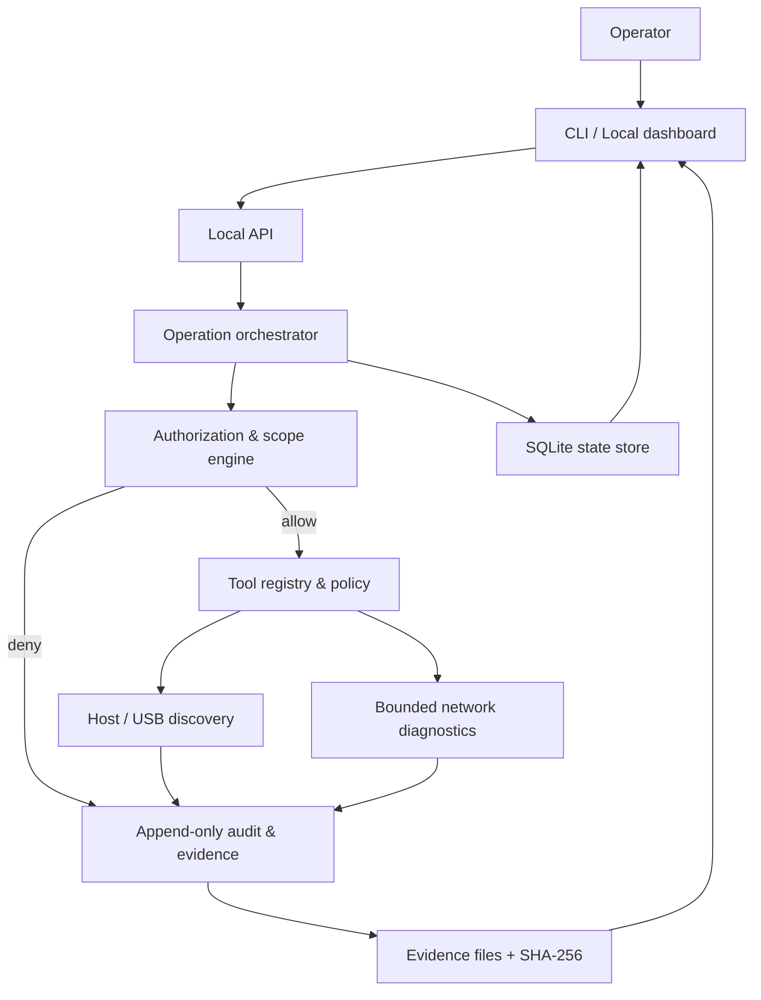
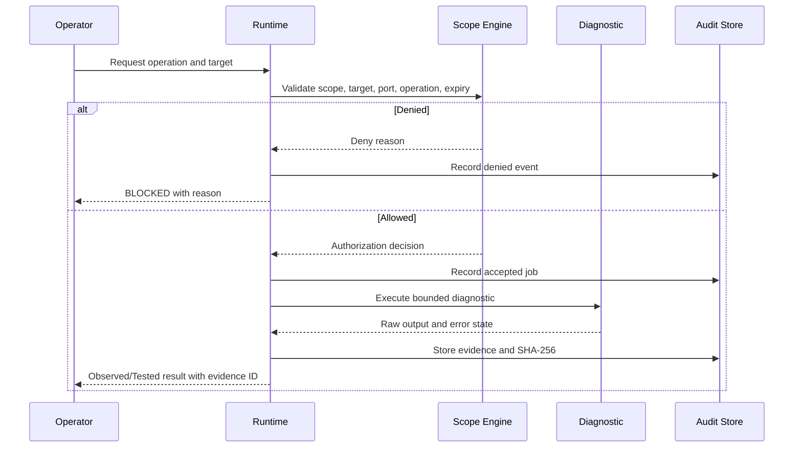

# Network Ninja Master Architecture

## Design objective

Network Ninja Master is an offline-first, bootable Linux workstation for **authorized** diagnostics and low-impact security assessment. The Linux x86_64 release uses a small Go runtime, a local loopback dashboard, SQLite-backed operational state, append-only audit records, and a Ventoy deployment layout. It is a practical first release, not a claim to support every vendor device, protocol, or operating system.

## Runtime components

| Component | Responsibility | Safety boundary |
|---|---|---|
| CLI and dashboard | Provide operator-visible controls, status, results, and release information. | Dashboard binds to loopback only; no network administration interface is exposed by default. |
| Operation orchestrator | Creates a job, checks policy, invokes one deterministic action, gathers evidence, and records an outcome. | No model output may directly invoke operations. |
| Scope engine | Parses `scope.json`, enforces expiry, targets, excluded targets, ports, operation types, and rate limit. | Denies before any active network call. |
| Device manager | Reads local host, network interface, USB, and serial inventory. | Read-only; unknown values remain unknown. |
| Scanner | Makes time-bounded TCP, TLS, and HTTP metadata requests. | Uses structured arguments/standard library APIs; no shell interpolation or payload delivery. |
| Tool registry | Contains allowlisted diagnostic tool metadata and integrity hash. | Tool definitions cannot enable arbitrary binary execution. |
| State store | Keeps jobs, scope metadata, and non-secret operational results in SQLite WAL. | Separate from evidence and secrets; uses parameterized queries. |
| Audit/evidence store | Writes append-only JSON events and evidence snapshots with SHA-256. | Records decisions and results; redacts obvious secret-like keys. |
| Optional planner adapter | Reports configured local AI endpoint status and can form a proposed plan. | Proposals are non-executable until a guarded backend operation is selected by the operator. |

## Operation lifecycle

## Data model

| Store | Content | Persistence location |
|---|---|---|
| `state.db` | Engagement scopes, jobs, device snapshots, tool metadata, status transitions | `${NETWORK_NINJA_DATA_ROOT}/state/` |
| `audit.jsonl` | Append-only event stream: actor, scope, request, decision, status, evidence digest | `${NETWORK_NINJA_DATA_ROOT}/audit/` |
| Evidence files | Raw JSON snapshots and guarded diagnostic results | `${NETWORK_NINJA_DATA_ROOT}/evidence/` |
| Configuration | Operator-local settings and approved scopes | `${NETWORK_NINJA_DATA_ROOT}/config/` |

The data root is resolved in this order: explicit `NETWORK_NINJA_DATA_ROOT`, detected USB data path, then a local writable fallback. The application reports its effective path and never treats ISO contents as a writable persistent store.

## Ventoy and live-image design

The live image contains the Linux kernel, initramfs, a minimal graphical/terminal environment, Network Ninja Master, launch service, documentation, and a pointer to the external data root. The ISO is stored under the Ventoy drive’s `/iso/` directory. Ventoy persistence configuration maps the exact ISO path to a backend image file held on the same first partition.[1]

The initial ISO avoids vendor tools, proprietary drivers, firmware images, and model weights. Those artifacts require licensing, hardware/profile validation, storage planning, and checksum/signature provenance before they can be included.

## External interfaces

| Interface | Address / format | Release behavior |
|---|---|---|
| CLI | `network-ninja` commands | Primary offline control surface. |
| Dashboard/API | `http://127.0.0.1:8000` | Local HTML plus JSON endpoints. No public bind. |
| Scope definition | JSON file | Validated before activation. |
| Evidence | JSON and JSONL | Hash-addressed references in job results. |
| Optional local model | OpenAI-compatible or Ollama endpoint | Detected dynamically; unavailable status is honest. |

## References

[1]: https://www.ventoy.net/en/plugin_persistence.html "Ventoy Persistence Plugin"
