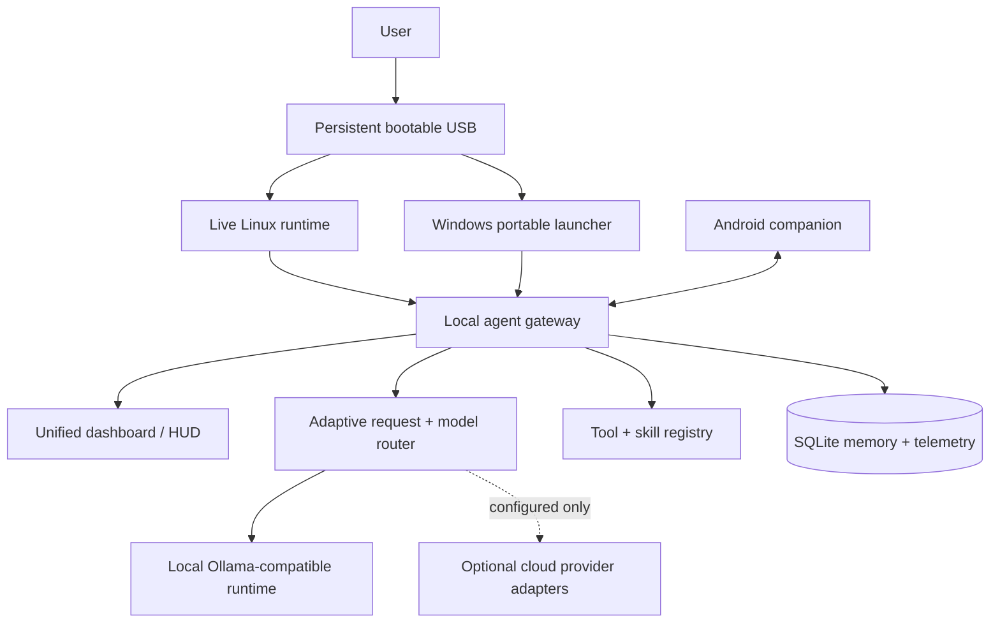

# Fresh Bootable USB Agent — Consolidated Build Specification

## Scope

This is a **fresh bootable USB environment**. It does not use, modify, package, or depend on the uploaded Android APK. The USB provides a persistent Linux live environment for the agent runtime, plus a Windows portable launcher for non-boot use and source assets for an Android companion.

The system presents one unified agent experience with an adaptive model router, WhiteRabbit Neo specialist option, local coding and reasoning models, optional online provider adapters, a browser dashboard/HUD, portable SQLite memory, skills/tools registry, benchmark suite, and an opt-in elevated Windows helper.

> **Booting is optional.** On a Windows 10/11 computer, the portable Windows launcher can run the same dashboard without replacing or modifying the host operating system. Booting the USB starts the isolated live runtime.

## Architecture



## Operating Modes

| Mode | Intended use | Runtime location | Network requirement |
|---|---|---|---|
| Bootable mode | Dedicated portable environment on a compatible x64 computer. | Persistent live Linux system on the USB. | None for local models; optional for updates and online providers. |
| Windows portable mode | Run from a Windows 10/11 x64 host without booting. | USB launcher starts the local runtime after user approval. | None for local models; optional online integrations. |
| Android companion mode | Command center and portable storage access on Android 12+. | Native companion app pairs with the local gateway when reachable. | Local network or USB-supported transport; phone system confirmations remain required. |
| Hybrid mode | Use local models first, external services only when an owner-configured credential and network are available. | Router selects based on task and active profile. | Varies by provider route. |

## Adaptive Performance System

The runtime is not configured around a fixed server assumption. At startup it records CPU architecture and core count, available RAM, swap pressure, GPU availability, free local/USB storage, USB mount performance, and network state. It converts those readings into one of six profiles: `ULTRA_LOW`, `LOW`, `MEDIUM`, `HIGH`, `WORKSTATION`, or `SERVER`.

| Subsystem | Adaptive action |
|---|---|
| Model selection | The router selects the smallest suitable installed model. Larger models are visible but not automatically loaded when memory is inadequate. |
| Context | The context manager uses task-scoped retrieval, compact event records, token budgets, and content hashes rather than replaying all memory and logs. |
| USB I/O | Hot logs, SQLite WAL files, and model runtime cache use a configurable host-local cache when allowed; the USB remains the canonical portable store. |
| Scheduling | Interactive work has priority. Background indexing, model warm-up, and benchmark jobs pause when memory or latency limits are exceeded. |
| Concurrency | Independent read-only tasks may run concurrently, but task count and tool calls are capped according to the active profile. |
| Telemetry | Startup time, first response latency, completion latency, RAM, CPU, storage, cache hits, provider usage, and tool duration are recorded locally. |
| Regression control | A change is retained only after functional tests and before/after benchmarks pass. |

## Local Model Bundles

The model installer is profile-driven. It verifies free space and hashes after download, then records the exact selected tag in the portable registry. It does not silently download multi-gigabyte artifacts during boot.

| Bundle | Model tags | Approximate model storage | Purpose |
|---|---|---:|---|
| `starter` | `deepseek-r1:1.5b`, `qwen2.5-coder:3b` | 4–6 GB | Lower-memory hardware and quick validation. |
| `balanced` | `WhiteRabbitNeo/Llama-3.1-WhiteRabbitNeo-2-8B`, `qwen2.5-coder:7b`, `deepseek-r1:8b`, `llama3.1:8b` | ~19.5 GB before runtime cache | The default full portable capability profile. |
| `expanded` | `balanced` plus `deepseek-r1:14b` and/or `qwen2.5-coder:14b` | Hardware-dependent | Larger planning or coding work when the host has sufficient RAM and disk. |

The `balanced` bundle requires a **64 GB USB at minimum** after allowing for the live environment, persistent data, and cache. A **128 GB USB** is the practical recommended capacity. The build must refuse a model pull that would breach the configured free-space reserve.

The verified local tags include Qwen 2.5 Coder 7B, DeepSeek R1 8B, Llama 3.1 8B, and WhiteRabbit Neo Llama 3.1 8B. The corresponding Ollama pages identify the first three as approximately 4.7 GB, 5.2 GB, and 4.9 GB artifacts respectively; the verified WhiteRabbit Neo distribution is approximately 4.7 GB. [1] [2] [3] [4]

## Model Router

The system routes **tasks**, not hidden credentials or copied application sessions.

| Task class | Initial route | Fallback |
|---|---|---|
| Deterministic operation | Native function | None; no model call. |
| Short planning / classification | DeepSeek R1 local profile | Smallest installed general model. |
| Code generation, review, syntax repair | Qwen 2.5 Coder | DeepSeek R1 local profile. |
| Security, log, or network analysis within the configured tool boundary | WhiteRabbit Neo specialist profile | General planner produces a constrained analysis plan first. |
| Broad system explanation and document work | Llama 3.1 Instruct | DeepSeek R1 local profile. |
| Owner-configured cloud route | Official credential-based provider adapter | Local models if unavailable. |

The router receives a compact task descriptor, available model state, current profile, and selected tool schemas. It makes only one selection per task cycle and records the outcome for performance tuning. It does not claim unrestricted or unattended capability and does not expose every tool to every model prompt.

## Tool, Skill, and Integration Boundary

The first fresh build implements a reliable core set: host profiling, model status, portable file indexing, text/code analysis, local task memory, benchmark execution, and owner-approved browser reads. Additional skills and external integrations are manifest-driven and disabled until configured.

The `advanced` integration option is separate from normal execution. On Windows, an elevated helper is invoked only through the operating system’s UAC flow, receives a one-time action specification, records the result, and exits. It is not a permanently elevated agent process.

## Bootable System Layout

```text
AI_AGENT_USB/
├── bootable/                # live-build configuration, persistent boot scripts
├── runtime/                 # gateway and frontend runtime
├── models/                  # model registry and optional downloaded model store
├── data/                    # SQLite, logs, exports, and cache metadata
├── config/                  # example files only; no secrets
├── windows/                 # portable launcher and elevation helper assets
├── android/                 # companion source and install package output
├── scripts/                 # setup, model pull, validation, benchmark scripts
├── docs/                    # install, security, performance, and recovery guidance
└── checksums/               # content hashes for downloaded assets
```

The bootable image uses a persistent data partition and does not promise automatic execution merely when plugged in. The boot menu and the Windows launcher both require a visible user action. The Android companion requires normal Android installation and permission confirmation.

## Delivery Targets

The repository will contain: a reproducible bootable-image build configuration; USB preparation script; local backend and HUD source; model manifest and verified pull script; Windows launch/elevation assets; Android companion source and bootstrap assets; benchmark suite; and a compressed source bundle. A full image containing the `balanced` model bundle is generated only where the build environment has enough free storage and the USB capacity is confirmed.

## References

[1]: https://ollama.com/WhiteRabbitNeo/Llama-3.1-WhiteRabbitNeo-2-8B "Ollama — WhiteRabbitNeo Llama 3.1 8B"
[2]: https://ollama.com/library/qwen2.5-coder:7b "Ollama — Qwen 2.5 Coder 7B"
[3]: https://ollama.com/library/deepseek-r1:8b "Ollama — DeepSeek R1 8B"
[4]: https://ollama.com/library/llama3.1:8b "Ollama — Llama 3.1 8B"
[5]: https://api-docs.deepseek.com/ "DeepSeek API Docs — optional provider integration"
